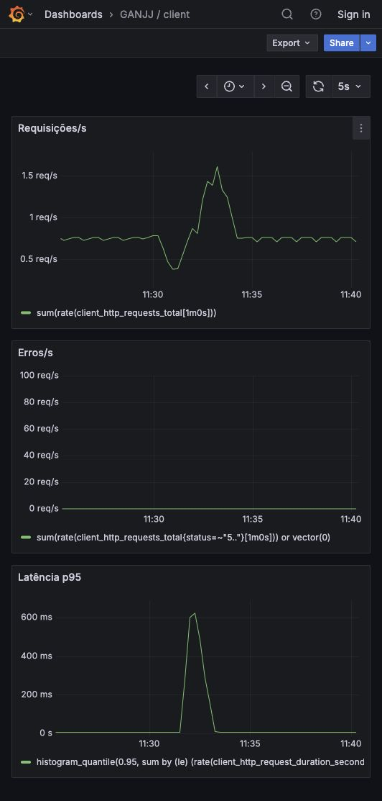

# Roteiro de apresentação N2 — client

Roteiro proposto: 3 minutos. O ensaio com o grupo ainda deve ser feito e cronometrado; os tempos abaixo são planejamento, não medição humana.

| Tempo | Demonstração | Evidência |
|---|---|---|
| 0:00–0:30 | Explicar a stack e a responsabilidade do serviço | README e contrato |
| 0:30–1:15 | Login/JWT e acesso protegido (200, 401 e 403) | `docs/evidence/2026-10-25/auth-client.json` |
| 1:15–2:00 | Pods, Service, réplicas, probes e Secret | Helm e validação no Minikube |
| 2:00–2:45 | Mostrar requisições, erros e p95 no Grafana | Painel abaixo |
| 2:45–3:00 | Resumir integração e limites conhecidos | `docs/n2-status.md` |

Antes do dia: testar áudio/tela, abrir os painéis, gerar tráfego fictício, conferir todas as réplicas, combinar a passagem de fala e anotar o tempo real de cada integrante. Não mostrar senhas ou tokens na apresentação.
